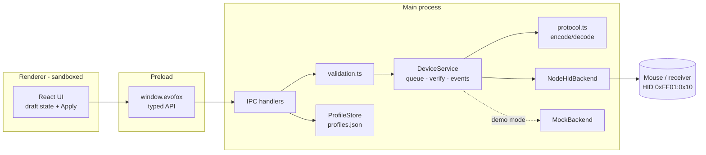
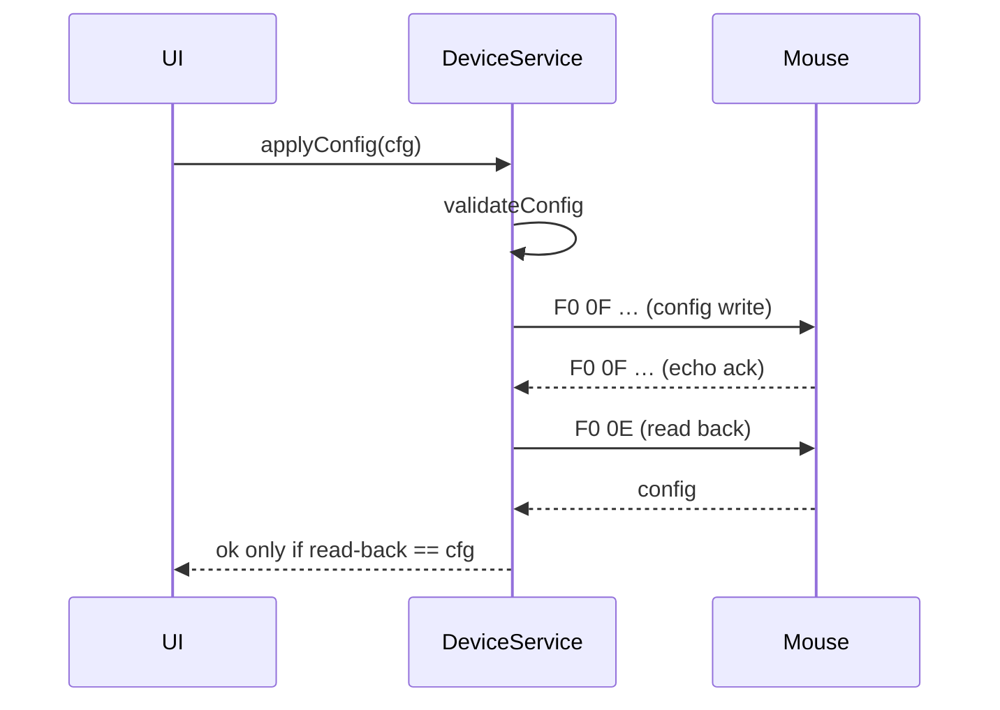

# ShadowTune — Windows Configurator for the EvoFox Shadow X Pro

## 1. Executive summary

ShadowTune is an unofficial Windows desktop app that configures the **EvoFox Shadow X Pro**
tri-mode wireless mouse without opening a browser. The official configurator is a web page
(https://shadowxpro.yjx2012.com/) that uses **WebHID** to send vendor-specific HID reports
directly to the mouse. We extracted that protocol from the page's JavaScript and confirmed it on
a real mouse on 2026-10-19: all reads work, and a config write was acknowledged and verified.

**Feasibility: high.** The app can read and write every setting on hardware, including DPI, polling rate,
lighting, sleep timer, debounce, sensor options, button map and battery. Macros are documented in
the vendor code but not implemented.

Status (2026-10-19): app built and running against the real mouse; 27 automated tests pass.
Remaining work is hands-on physical verification and installer polish — see `plan.md`.

## 2. Goals and non-goals

**Goals**
- Configure DPI stages, polling rate, buttons, lighting, sleep/wake, debounce, lift-off, sensor options.
- Show connection mode, firmware, battery and charging state.
- Local profiles with import/export.
- Verify every write by reading it back; never pretend a change worked.
- Mock device so development works without hardware.

**Non-goals (MVP)**
- Firmware updates or any firmware write.
- Macro editing (protocol known, deferred — see §11).
- Bluetooth-mode configuration (official tool doesn't support it either).
- Cloud sync, accounts, telemetry.
- macOS/Linux (the code is portable, but only Windows is tested).

## 3. Hardware specifications and evidence

| Spec | Value | Source |
|---|---|---|
| Model | EvoFox Shadow X Pro (vendor model code "P6") | Amazon B0GH7NC745; configurator `mouse_info_p6.json` |
| Connectivity | Bluetooth, 2.4 GHz receiver, USB-C wired | product page |
| Sensor / max DPI | S203 / 6400 (configurator range 200–6400) | product page; model file `dpiConfig` |
| Polling | up to 1000 Hz (indices 125/250/500/1000) | product page; configurator |
| Buttons | 6 physical; 5 remappable + DPI button fixed | configurator key layout (5 slots) |
| Software | Web configurator, Chrome/Edge, WebHID | https://support.amkette.com/software/evofox-shadow-x-pro-software/ |
| Receiver USB IDs | VID 0xA8A5, PID 0x2255 | Windows PnP + node-hid, 2026-10-19 |
| Receiver firmware | 2.1.3, built Mar 20 2026 | device version reply |

Full byte-level details: `docs/PROTOCOL.md`.

## 4. Confirmed facts, assumptions, open questions

| Capability | Status | Evidence |
|---|---|---|
| Configurator uses WebHID, talks directly to device | **Confirmed** | support page + JS (`navigator.hid`, `sendReport`) |
| Vendor collection 0xFF01/0x10, report ID 0xF0 | **Confirmed** | hardware probe |
| Read firmware version | **Confirmed** | hardware |
| Read battery % / charging | **Confirmed** (wireless, 100 %, not charging) | hardware |
| Read full config | **Confirmed** | hardware |
| Write config (DPI, polling, light, sleep, etc.) | **Partially verified** — identical write acked & verified; changed values not yet observed physically | hardware |
| Read button map | **Confirmed** | hardware |
| Write button map | **Partially verified** — identical write acked & verified; remap not yet tested physically | hardware |
| DPI stages 200–6400 | **Partially verified** | model file; values read back |
| Polling rate 125/250/500/1000 | **Partially verified** | read 500 Hz; effect not measured |
| RGB modes (7 effects incl. off) | **Partially verified** | read mode 6 = off |
| Custom RGB colour/brightness/speed | **Unsupported** in protocol seen (model file mentions it; no bytes in config frame) | JS |
| Auto-sleep after idle (2.4 G/BT) | **Partially verified** — timer field read (15 min) | hardware + UI text |
| Sleep timeout configurable 0–100 min (0 = never) | **Partially verified** | JS + read |
| Wake on click vs move | **Partially verified** | JS + read |
| Lighting off while moving | **Partially verified** | JS + read |
| Wired-mode behaviour | **Unknown** — not tested | — |
| Bluetooth configuration | **Unknown / likely unsupported** | configurator only filters USB |
| Onboard profiles | **Unsupported** — official app stores profiles in browser localStorage | JS |
| Macros (onboard, 4 KB) | **Hypothesis** | JS |
| Unsolicited DPI/battery events | **Hypothesis** | JS |

**Official UI scope for this model:** the vendor app shows only DPI, buttons, lighting effect,
polling rate (fixed 1000 Hz on cable) and scroll direction for the Shadow X Pro. The sleep, wake,
move-light, debounce, lift-off, eSports and sensor fields come from other models' panels. Our app
keeps them on a separate **Advanced** tab labelled as unverified.

**Open questions:** wired PID; whether polling 250 Hz is valid over USB; exact meaning of
sensor bit 0x10 (two vendor UI panels disagree); `mouse_status` event meaning; whether the
receiver answers while the mouse sleeps (expected: no); button write ack format.

## 5. Technical feasibility assessment

Feasible with low protocol risk. The protocol is simple: fixed 64-byte frames, with the command echoed in
the reply. It is fully described by the vendor's own code, and the core of it is confirmed on
hardware. Windows lets user-mode apps open vendor-defined HID collections without admin rights or
a driver. Remaining risks are behavioural (sleep, wired mode), not protocol discovery.

## 6. Technology stack (changed from the original proposal)

| Layer | Choice | Why |
|---|---|---|
| Shell | **Electron 33** | Tauri needs Rust + MSVC (not installed, multi-GB); Tauri's WebView2 also can't use WebHID |
| HID | **node-hid 3.1.2** (main process) | Proven on this machine on day one; N-API prebuilds, no compile |
| UI | React 18 + TypeScript + Tailwind v4 | as proposed |
| Build | electron-vite 2, Vite 5 | one config for main/preload/renderer |
| Storage | JSON file in `%APPDATA%` | tiny data; SQLite not justified |
| Tests | Vitest | protocol tested against real captured frames |
| Installer | electron-builder (NSIS, per-user) | no admin needed |

Trade-off accepted: ~80 MB installer and higher RAM than Tauri.

## 7. High-level architecture



Write flow:



## 8. Repository structure

```
evofox/
  project.md  plan.md  readme.txt
  docs/PROTOCOL.md
  package.json  electron.vite.config.ts  tsconfig.node.json  tsconfig.web.json  vitest.config.ts
  src/
    shared/   types.ts  validation.ts  keymap.ts  api.ts
    main/     index.ts  profiles.ts
      device/ protocol.ts  transport.ts  nodeHidBackend.ts  mockBackend.ts  deviceService.ts
    preload/  index.ts
    renderer/ index.html  src/ (main.tsx, App.tsx, components/…)   ← to do
  tests/      protocol / deviceService / validation / profiles     ← to do
  scripts/probe.mjs                                                ← to do
```

## 9. Device protocol investigation plan

Done: JS extraction (§3 sources), read probe, idempotent write. Remaining experiments:
1. Change each config field from the app; confirm physically (DPI feel/LED, lighting, a
   polling-rate tester site for Hz).
2. Button write: remap Forward → Middle click, test, restore defaults.
3. Repeat reads in **wired** mode; record VID/PID.
4. Optional: capture the official app with Wireshark + USBPcap while it applies settings to
   confirm byte-for-byte parity.

## 10. Auto-sleep and battery investigation plan

| Question | Experiment |
|---|---|
| Does the mouse sleep in 2.4 GHz? | Set sleep = 1 min; idle; poll config read — expect timeouts → app shows "asleep" |
| Bluetooth sleep | Pair via BT, same timing test by observing LEDs/cursor (not configurable from app) |
| Wired | Expect no sleep; confirm reads continue |
| RGB off independently | Toggle move-light option; observe LEDs while moving |
| Wake by move vs click | Set each wake mode, verify which input wakes it |
| Battery accuracy | Log % every 5 min across a discharge; compare with charging flag on cable |

## 11. MVP scope and roadmap

| Phase | Content | State |
|---|---|---|
| 1 Discovery | protocol + feasibility | **done** |
| 2 Foundation | Electron app shell, device service, mock, logging | **mostly done** (UI shell pending) |
| 3 Basic config | DPI, polling, lighting, sleep, debounce, buttons UI | to do |
| 4 Profiles & diagnostics | local profiles, import/export, log view, battery | backend done, UI to do |
| 5 Packaging | NSIS installer, docs, install/upgrade/uninstall tests | to do |
| Later | macros, tray battery, per-app profiles | backlog |

## 12. Requirements

**Functional**
- Auto-detect receiver or cable within 2 s of plug-in; show mode, firmware and battery.
- Read all settings on connect; edit locally; "Apply" writes and verifies.
- Clear message when the receiver is present but the mouse is asleep.
- Restore factory defaults (confirmed by user).
- Profiles: save, apply, rename, delete, export, import (validated).
- Demo device toggle.

**Non-functional**
- No admin rights. No network access at runtime.
- Renderer sandboxed; contextIsolation on; CSP; navigation blocked.
- All device input validated in the main process, regardless of UI checks.
- Single-instance (one HID owner).
- Startup < 3 s; a write plus its verification < 1 s.

## 13. Testing strategy

- **Unit:** protocol encode/decode against the real captures in `docs/PROTOCOL.md` §5; validation rules.
- **Service:** DeviceService + MockBackend — connect, read, write-verify, rejection of invalid
  input, sleeping mouse, unsolicited events, unplug.
- **Profiles:** temp-dir store, import of malformed files.
- **Manual hardware checklist:** §9 and §10 experiments, both wireless and wired.
- **Packaging:** clean-VM install, upgrade over previous version, uninstall leaves no service/driver.

## 14. Security and hardware safety

- Only commands present in the official configurator are sent; no firmware/bootloader commands exist in the app.
- Writes only on an explicit user "Apply" (the official app writes on every slider move).
- Every write is range-checked, then verified by read-back; mismatches are reported, never hidden.
- The left button can't be disabled; fixed slots 6–8 are preserved, not zeroed (the official
  "reset keys" zeroes them).
- Profiles stay local; the log contains only HID bytes, no personal data.
- Macros deferred because they involve multi-chunk writes with checksums.

## 15. Risks and mitigations

| Risk | Impact | Mitigation |
|---|---|---|
| Firmware variants change offsets | wrong settings | version shown; verify-after-write; mismatch warning |
| Browser configurator holds the device | open fails | friendly error: close browser tab |
| Mouse asleep → timeouts | confusing UI | "asleep" state, auto-retry on poll |
| Button write untested | bad mapping | defaults restore; official web app as fallback |
| Electron footprint | larger install | acceptable; revisit Tauri if size matters |
| Legal/IP | — | own implementation; no vendor code copied; interoperability use |
| npm 12 blocks install scripts | Electron binary missing | `allowScripts` in package.json; manual `install.js` |

## 16. Acceptance criteria

- **Phase 2:** `npm run dev` opens the app; demo device shows full state; real receiver is detected and read.
- **Phase 3:** each setting changes physically on the mouse and survives replug; read-back matches.
- **Phase 4:** profile round-trip (save → export → import → apply) produces identical device state.
- **Phase 5:** installer runs without admin on a clean Windows 11 PC; uninstall is clean.

## 17. Initial development tasks (priority order)

1. Renderer UI (header, Performance, Lighting & power, Buttons, Profiles, Diagnostics).
2. Unit + service tests against real captures.
3. Hardware verification checklist (incl. first button write, wired mode, sleep).
4. electron-builder config + installer.
5. User README.

## 18. Questions needing physical testing or vendor clarification

- Wired-mode PID and protocol parity.
- Does 250 Hz work over USB cable?
- Sensor flag bit 0x10: ripple control or line correction?
- Meaning of the `mouse_status` (F0 ED) event.
- Is there any Bluetooth configuration channel?
- Does the vendor (Amkette) publish an SDK or permit third-party configurators? (No public SDK found.)
